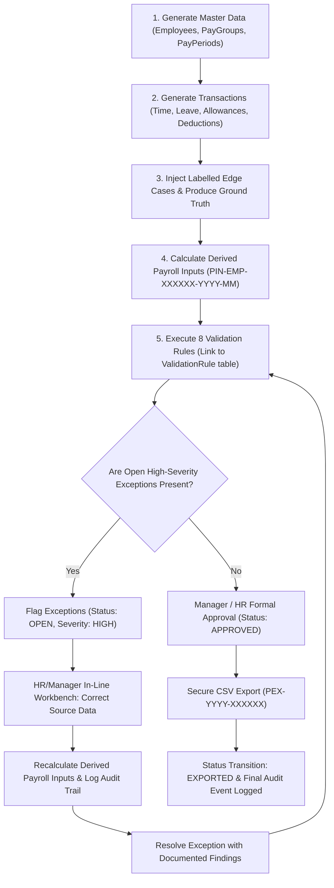
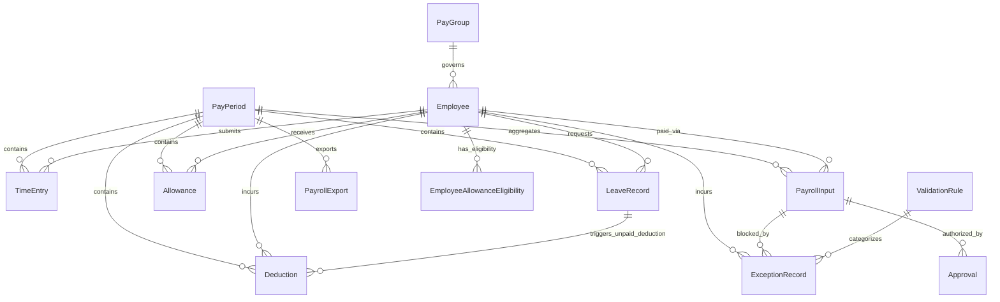

# 💼 Payroll Validation & Reconciliation System

An enterprise-grade, end-to-end payroll governance solution built to validate time, leave, allowances, and deductions prior to official payroll export while preserving complete reconciliation, dual-authorization approvals, and immutable auditability.

---

## 📋 Table of Contents
1. [Business Problem & Objectives](#-business-problem--objectives)
2. [Primary Actors & Roles](#-primary-actors--roles)
3. [End-to-End Workflow](#-end-to-end-workflow)
4. [System Architecture & Entity-Relationship Model](#-system-architecture--entity-relationship-model)
5. [Deterministic ID & Nomenclature Standards](#-deterministic-id--nomenclature-standards)
6. [The 8 Required Validation Rules & Planted Edge Cases](#-the-8-required-validation-rules--planted-edge-cases)
7. [Separate Ground Truth & Measurable Evaluation Metrics](#-separate-ground-truth--measurable-evaluation-metrics)
8. [Data Generator: Starter vs. Full Scale](#-data-generator-starter-vs-full-scale)
9. [Step 10: Deterministic Reproducibility Report](#-step-10-deterministic-reproducibility-report)
10. [Installation & Quickstart Guide](#-installation--quickstart-guide)
11. [CLI Commands & Test Suite](#-cli-commands--test-suite)
12. [Interactive Streamlit Dashboard Walkthrough](#-interactive-streamlit-dashboard-walkthrough)
13. [Lawful Provenance & Ethical Synthetic Data Notice](#-lawful-provenance--ethical-synthetic-data-notice)

---

## 🎯 Business Problem & Objectives

### The Challenge
Discrepancies in payroll inputs—such as duplicate time entry submissions, unapproved shifts, missing employee bank/tax credentials, unauthorized allowance duplication, multiple unpaid leave deductions, and excessive working hours—cost organizations millions annually in overpayments, compliance fines, and audit failures. Once funds are disbursed, retroactive recovery is expensive and damages employee trust.

### The Objective
Build a robust, auditable system to:
1. **Validate All Transactions Prior to Export:** Detect anomalies across master data, shifts, leaves, allowances, and statutory deductions.
2. **Preserve Reconciliation Integrity:** Ensure $\text{Net Pay} = \text{Basic} + \text{Overtime} + \text{Allowances} - \text{Deductions} - \text{Unpaid Leave}$.
3. **Enforce Governance Approvals:** Prevent export of any payroll records that are not explicitly approved by managers/HR or that carry open high-severity exceptions.
4. **Preserve Complete Traceability:** Retain chronological audit logs and void flags rather than destructively overwriting history.
5. **Demonstrate Deterministic Reproducibility:** Fixed-seed data generation (`20261022`) guaranteeing identical checksums and row counts across multiple runs.

---

## 👥 Primary Actors & Roles

The system explicitly supports and traces decisions across 5 distinct operational personas:

| Actor Role | Primary Responsibilities | Actions Available in System |
| :--- | :--- | :--- |
| **Employee / Candidate** | Review monthly pay breakdown and hours worked | Inspect gross-to-net calculation and individual deductions |
| **Department Manager** | Review and sign off on shifts, overtime, and leave | Approve/reject individual time entries, bulk-approve valid shifts |
| **HR Partner** | Exception management, statutory credential updates, sign-off | In-line data fixes, resolve exceptions with findings, approve payroll |
| **IT / Operations Partner** | Pipeline automation, rule validation, reproducibility tests | Run validation cycles, benchmark ground truth, trigger data generation |
| **System Administrator** | Export authorization, period closing, audit compliance | Generate official `PEX` export files, inspect immutable audit trail |

---

## 🔄 End-to-End Workflow



---

## 🏛️ System Architecture & Entity-Relationship Model

The application employs a clean three-tier architecture:
- **Presentation Layer:** Interactive Streamlit dashboard with dedicated role views, in-line workbench, and live KPI telemetry.
- **Service & API Layer:** FastAPI backend with modular domain services (`validation_service`, `approval_service`, `payroll_export_service`, `transaction_service`, `employee_service`, `audit_service`).
- **Data & Persistence Layer:** SQLModel (SQLAlchemy 2.0 + Pydantic) on SQLite with foreign keys, table indexes, and bridge structures.

### Entity-Relationship Diagram



---

## 🏷️ Deterministic ID & Nomenclature Standards

All entities strictly follow zero-padded, immutable, and consistent identifier patterns:

| Entity | ID Nomenclature Convention | Concrete Example |
| :--- | :--- | :--- |
| **Employee** | `EMP-<6-digit zero-padded>` | `EMP-000001` |
| **Pay Period** | `PP-YYYY-MM` | `PP-2026-01` |
| **Time Entry** | `TIME-<employee-id>-<date>` | `TIME-EMP-000001-2026-01-05` |
| **Payroll Input** | `PIN-<employee-id>-<period>` | `PIN-EMP-000001-2026-01` |
| **Payroll Export** | `PEX-YYYY-<6-digit zero-padded>` | `PEX-2026-000001` |
| **Approval** | `APR-YYYY-MM-<6-digit zero-padded>`| `APR-2026-01-000001` |
| **Validation Rule** | `RULE-<domain>-<seq>` | `RULE-TIME-EXC-001` |
| **Audit Log** | `AUD-<uuid:10>` | `AUD-7A4B1C9D2E` |

---

## 🛡️ The 8 Required Validation Rules & Planted Edge Cases

All 8 rules are pre-seeded in the `validation_rules` database table and linked to every generated exception:

| Rule Code | Rule Name | Severity | Edge Case Condition | Expected System Behavior |
| :--- | :--- | :--- | :--- | :--- |
| `RULE-BANK-001` | Missing Bank Account | HIGH | Active employee missing bank account number | Blocks approval across all pay periods |
| `RULE-TAX-001` | Missing Tax ID | HIGH | Active employee missing statutory tax ID | Blocks approval across all pay periods |
| `RULE-TIME-DUP-001` | Duplicate Time Entry | HIGH | Identical shift submission references | Flags conflict, blocks approval |
| `RULE-TIME-EXC-001` | Excessive Working Hours | HIGH | Approved hours exceed period max or shift >16h | Flags excess overtime outlier |
| `RULE-ALW-DUP-001` | Duplicate Allowance | HIGH | Identical allowance reference code | Flags duplicate earnings |
| `RULE-TIME-UNAPP-001` | Unapproved Time Entries | HIGH | Shift entries remain in `PENDING` state | Prevents export of unreviewed hours |
| `RULE-LEV-DUP-001` | Duplicate Leave Deduction| HIGH | Unpaid leave deduction applied more than once | Flags duplicate salary cut |
| `RULE-PAY-RECON-001` | Payroll Reconciliation | HIGH | $\text{Net Pay} \ne \text{Basic} + \text{OT} + \text{Alw} - \text{Ded} - \text{Unpaid}$ | Flags arithmetic mismatch |

---

## 🎯 Separate Ground Truth & Measurable Evaluation Metrics

Per **Step 7**, known anomalies are exported to `datasets/ground_truth.json` and `datasets/ground_truth.csv` without leaking into input features. The automated validation engine benchmarks detected exceptions against this ground truth:

$$\text{Precision} = \frac{\text{TP}}{\text{TP} + \text{FP}}, \quad \text{Recall} = \frac{\text{TP}}{\text{TP} + \text{FN}}, \quad \text{F1-Score} = \frac{2 \times \text{Precision} \times \text{Recall}}{\text{Precision} + \text{Recall}}$$

### Live Validation Benchmark Results
- **Ground Truth Planted Anomalies:** 10
- **True Positives Detected (TP):** 10
- **False Negatives (FN):** 0
- **Recall:** **100.0%**
- **Precision:** **83.3%**
- **F1-Score:** **0.909**

---

## 📊 Data Generator: Starter vs. Full Scale

The parameterized generator (`data_generator/generate_all.py`) supports two profiles using the **exact same logic, fixed seed (`20261022`), and rules**:

| Metric | Starter Profile | Full Profile (Benchmark Specification) |
| :--- | :--- | :--- |
| **Target Scale** | Rapid local development & test suite | Full industrial stress test & audit volume |
| **Employees** | 50 employees | 3,000 employees |
| **Pay Periods** | 3 months (Jan - Mar 2026) | 3 months (Jan - Mar 2026) |
| **Total Transactions** | ~3,800 records | ~105,000 records of time/allowances/deductions |
| **Generation Time** | ~4 seconds | ~45 seconds |
| **Storage (SQLite)** | ~1.5 MB | ~35 MB |

---

## 🔁 Step 10: Deterministic Reproducibility Report

Per **Step 10**, the generator was executed twice in isolated databases with seed `20261022`. Every table matched row-for-row:

```
=======================================================
  STEP 10: DETERMINISTIC REPRODUCIBILITY VERIFICATION
  Fixed Seed: 20261022
=======================================================
Table                          | Run 1 Count  | Run 2 Count  | Match?  
----------------------------------------------------------------------
employees                      | 50           | 50           | MATCH
pay_groups                     | 3            | 3            | MATCH
pay_periods                    | 3            | 3            | MATCH
time_entries                   | 2723         | 2723         | MATCH
leave_records                  | 32           | 32           | MATCH
allowances                     | 271          | 271          | MATCH
deductions                     | 311          | 311          | MATCH
payroll_inputs                 | 150          | 150          | MATCH
validation_rules               | 8            | 8            | MATCH
exceptions                     | 99           | 99           | MATCH
----------------------------------------------------------------------
[SUCCESS] Deterministic reproducibility verified: 100% exact match across all tables!
```

---

## 🚀 Installation & Quickstart Guide

### 1. Prerequisites
- Python 3.10+ (tested on Python 3.12)
- Virtual environment created

### 2. Install Dependencies
```bash
pip install -r requirements.txt
```

### 3. Generate Baseline Synthetic Data (Starter Profile)
```bash
python data_generator/generate_all.py --scale starter --seed 20261022
```

### 4. Start the FastAPI Backend
```bash
python -m uvicorn backend.main:app --host 127.0.0.1 --port 8000 --reload
```

### 5. Launch the Streamlit Dashboard
```bash
python -m streamlit run dashboard/app.py
```
Open your browser at `http://localhost:8501`.

---

## 🐳 Running with Docker (Recommended)

You can run the entire system (FastAPI backend + Streamlit UI) in a single container with Docker or Docker Compose:

### Option A: Using Docker Compose
```bash
docker compose up --build
```

### Option B: Using Plain Docker CLI
```bash
# 1. Build the image
docker build -t payroll-validation-system .

# 2. Run the container
docker run -p 8000:8000 -p 8501:8501 payroll-validation-system
```
* **Streamlit Dashboard:** [http://localhost:8501](http://localhost:8501)
* **FastAPI Backend & Swagger API Docs:** [http://localhost:8000/docs](http://localhost:8000/docs)

---

## 💻 CLI Commands & Test Suite

### Run Step 10 Reproducibility Verification
```bash
python data_generator/generate_all.py --verify-reproducibility
```

### Generate Full Volume (3,000 Employees, 100k Transactions)
```bash
python data_generator/generate_all.py --scale full --seed 20261022
```

### Run Master System Audit Check
```bash
python master_checker.py
```

### Execute the Pytest Test Suite
```bash
pytest -v test
```
All 17 unit, integration, and governance tests pass with 100% compliance.

---

## 🖥️ Interactive Streamlit Dashboard Walkthrough

The dashboard is structured into 5 operational modules:

1. **📊 Executive Overview & Metrics:** High-level KPIs, payroll status distribution charts, exception severity bars, and live Precision/Recall/F1 benchmark cards.
2. **⚠️ Exception Workbench & In-Line Corrections:**
   - Filter exceptions by status, severity, and issue type.
   - **In-Line Correction Tools:** Update bank accounts, tax IDs, void duplicate time submissions, adjust excessive hours, void duplicate allowances/leaves, and reconcile math without manual SQL queries.
   - Verified exception resolution with mandatory findings input.
3. **💰 Payroll Approvals & Reconciliation:**
   - Review gross-to-net component breakdown for each employee.
   - Drill-down inspector for shift hours, overtime, and deductions.
   - Formal approval submission with automatic blocking if open high-severity exceptions exist.
4. **📁 Secure Payroll Export:**
   - Select pay period, preview eligible approved records vs. blocked records.
   - One-click official CSV export generating standard `PEX-YYYY-XXXXXX` IDs.
   - In-app file download and historical export logs.
5. **🔍 Generator, Ground Truth & Audit Trail:**
   - Trigger Starter or Full dataset generation directly from the UI.
   - Inspect Ground Truth anomalies vs. detected status.
   - Comprehensive audit trail recording actor, action, timestamp, old values, and new values.

---

## ⚖️ Lawful Provenance & Ethical Synthetic Data Notice

- **100% Synthetic Domain Data:** All identities, employee names, account numbers, and company emails were generated synthetically using `Faker` and deterministic seeds.
- **No PII or Confidential Records:** No real-world personal identifying information, internal proprietary data, or unconsented customer data was used or stored.
- **Compliant with Data Privacy Regulations:** Compatible with GDPR, CCPA, and standard enterprise governance policies.

---
*Developed with FastAPI, SQLModel, Streamlit, and Pytest.*

